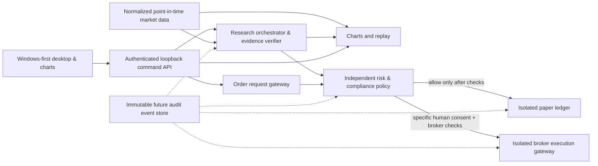

# MeridianDesk — Founder-Level Engineering Execution Plan
**Program:** MDR-2026-FOUNDATION · **Created:** 2026-11-26 · **Target:** Windows-first, local-first personal workstation; conditional 2027 beta.

> This file is a proposed, evidence-gated engineering plan. It does not certify production readiness, trading performance, market data rights, security audits, or executed test results. Founder approval is required for critical merges and all production/live-trading changes.

## 1. Baseline and boundaries

Inspected the GitHub `main` branch and the following source files: `README.md`, `desk.py`, `broker.py`, `ledger.py`, `market.py`, `analytics.py`, `integrations.py`, `launch.py`, `swarm.py`, and available test-suite source. The README explicitly distinguishes the Git checkout from the full Windows deployment on `E:\\MeridianDesk`. No local installation, Windows GUI, exchange credentials, or live broker account was examined here.

**Observed source-level capabilities:** authenticated loopback service; web interface; Windows Edge launcher and optional native launcher source; fixed symbol watchlist; provider-labelled public/synthetic OHLC and Coinbase ticker handling; deterministic risk research; synthetic DEMO; SQLite paper ledger with idempotent trade IDs; broker adapter for Alpaca paper/live with typed confirmations and pending-order reconciliation; persistent trading halt; offline Python tests; optional research workers. The repository does **not** currently expose a CI workflow in the inspected source tree.

**Unverified:** deployment runtime, vendor market data access/entitlement, bundled workers running successfully on the user's Windows machine, live broker behavior, backtest validity outside the implemented fixture, end-to-end threat model, cryptographic audit immutability, independent audits, licensing review and any future-facing modules.

## 2. Gap analysis: verified code boundary versus accepted target

| Priority | Capability | Code evidence | Gap / required proof |
|---|---|---|---|
| P0 | Personal workstation launch | `launch.py`, `desk.py`, `app/` | Installation reproducibility, Windows UI smoke test, signed packaging and startup diagnostics |
| P0 | Source-labelled global data | `market.py` | Only a fixed instrument list; independent provider quality checks, licensed entitlements, temporal replay, market calendar handling |
| P0 | Deterministic protection | `analytics.py`, `ledger.py`, `broker.py` | Fault injection and complete order-state model; verify all halt/restart/retry paths across supported broker modes |
| P0 | Paper-account lifecycle | `ledger.py`, `test_orders.py`, `test_desk.py` | Explicitly test full offline vertical slice in CI; multi-account and FX support are future work |
| P0 | Source-to-execution audit | `ledger.py` stores category/detail logs | No append-only cryptographic chain, signed provenance record or independently verifiable decision lineage |
| P1 | Reproducible research evidence | `analytics.py`, `filings.py`, `swarm.py` | Primary-source citation identifiers, input snapshot hash, point-in-time joins, calibration and adversarial verifier |
| P1 | Secure research jobs | `desk.py` thread pool; `integrations.py` process workers | Persistent queue/checkpoint/budgets, capability isolation, injection and prompt-contamination testing |
| P1 | Deployment/recovery | `launch.py`, SQLite | Tested encrypted backup, migration rollback, credentials revocation, incident rehearsal |
| P2 | Charting and workflow UX | `app/app.js`, `app/research.js`, `app/app.css` | Performance benchmark, dock/multi-monitor, advanced replay, accessibility and keyboard workflows |
| P2 | Global universe | `market.py` symbols | Futures/options, bonds, advanced FX/crypto, macro, market-depth and commodity data are planned; exclude Indian exchanges |
| P2 | Model gateway and multi-agent cognition | `integrations.py`, `swarm.py` | Full local/cloud gateway, verified memory, research accuracy evaluation, model budgets and permission matrix |
| P3 | Public readiness | README + test files | Independent security review, license/legal checks, signed distribution, beta feedback protocol, human-approved public-live gate |

The source and tests are **not** substitutes for independent assurance. Track claims as proposed → source-observed → tested → production-validated.

## 3. Target architecture

**Isolation contracts:** Research/LLM processes are read-only with respect to trade dispatch. Requests from text, third-party documents, plugins or model output have no authority to mutate live-trading controls. Paper and live accounts are separated. Browser-local origin/authentication is necessary but not sufficient for trusted local service access. Account credentials remain out of browser state, agent context, logs and subprocess environments.

**Data contract:** each observation will eventually include instrument ID, event UTC time, received UTC time, venue/source, delay/freshness, trading session, raw provenance, canonical units/currency, correction/version and simulation flag. Never infer level-2 order-book information from OHLC bars without labeling it inferred.

**Trading contract:** no new order on stale/unknown quote, invalid risk, invalid policy, halt or uncertain broker reconciliation; client order IDs are idempotent; only the human can authorize specific live orders. Shutdown does not cancel resting broker orders; the operator must be informed and reconcile explicitly.

## 4. Milestones with measurable acceptance

### M0 — Reproducible source baseline (first branch)
- Inventory source/test files, review scopes and gaps; capture `main` commit reference.
- Record all 100 decisions and classify each feature as proposed / source-observed / tested / production-validated.
- Add an **offline-only** repeatable test gate. No market API token, cloud model, or broker credential.
- **Gate:** documented test commands, reported pass/fail results, no silent test skips, no critical merge without founder approval.

### M1 — Secure end-to-end paper vertical slice (highest priority)
User opens a Windows/local shell, selects DEMO, inspects explicitly synthetic OHLC and risk research, places one local paper order, sees portfolio+audit update, confirms identical retry is idempotent, halts, restarts, and verifies the halt persists.

- **Data:** DEMO market source carries `live=False`, `stale` and source provenance; an indicative/stale real symbol cannot be paper-filled.
- **Research:** deterministic result includes a separate entry veto and reasons; data and result reproducibility verified with frozen fixtures.
- **Risk:** zero fills following a persistent halt; zero additional fills for duplicate order IDs; exposure and limit/fee checks fail closed.
- **Execution:** zero live broker submissions or network calls during this gate. `MERIDIAN_BROKER=off` and credentials blank in CI.
- **Audit:** paper fill and control changes appear as local audit entries (cryptographic integrity remains future work).
- **Gate:** unattended unittest pass and a Windows GUI walk-through on the real deployment; any failure blocks promotion. Treat tests running elsewhere as additional evidence, not an assumption.

### M2 — Source-quality and research verification
- Provider fixture/clock tests, stale-quote logic, data lineage, replayable input snapshots.
- Attach evidence identifiers and reproducible calculations to selected research claims; keep missing citations and model uncertainty visible.
- **Gate:** no unlabelled synthetic/live interchange, no look-ahead in replay, documented evaluated benchmarks and failures.

### M3 — Robust workstation and paper portfolio
- UI performance profiling on target laptop, complete paper transaction invariants, local backup/restore, deterministic startup checks and threat-model review.
- **Gate:** measure startup and chart latency on actual target Windows hardware; set numerical service-level targets after measurement, not guesswork.

### M4 — Controlled early access
- Security and legal/data licensing review, provider cost controls, permission review, consent-based diagnostics, support documentation and staged beta.
- **Gate:** separately approved alpha/beta based on evidence, not feature counts.

### M5 — Separate live/institutional eligibility (not authorized)
- Requires an independent broker reconciliation protocol, account and venue controls, legal/market-data licensing review, documented security validation, disaster recovery exercise and explicit founder sign-off. **No new live execution is part of M0–M1.**

## 5. Engineering workflow

1. One scoped change per branch/PR; identify requirement IDs (e.g., Q005, Q034, Q040, Q082, Q083).
2. Reproduce a gap with a deterministic failing test or verified source-level evidence.
3. Implement minimum change with stable interfaces and migration plan; preserve working code.
4. Run offline tests, security-sensitive regressions and full Windows-specific checks where available.
5. Publish evidence: test environment/command, results, untested behavior, risks, rollback instructions.
6. Founder reviews critical merges and every trading-policy or privilege change.

## 6. First-branch change list and limitations

This initial branch adds the founder requirements map, this execution plan, an isolated DEMO vertical-slice contract test, and an offline-source CI gate. It does not upgrade to institutional AI, alter trading algorithms, contact brokers, or introduce subscription/billing functionality. The GitHub runner cannot validate the full E-drive Windows deployment or installed Kronos/Ruflo/TradingAgents environments.

## 7. Risk register and immediate engineering priorities

| Risk | Mitigation / decision |
|---|---|
| Live order harm | Preserve default-off broker mode and separate human-confirmed live gate; explicit reconciliation on uncertain submission |
| Licensing and market-data rights | Attribute feeds; no unreviewed redistribution or unsupported claims of real-time access |
| AI overconfidence / poisoning | Source verification, explicit uncertainty and default-deny tool authorization |
| Provider outage or stale price | Fail closed for execution; keep chart/research staleness visible |
| Unsupported institutional claims | Separate target specification from tests and deployment evidence |
| Resource exhaustion | Local/free-first development and hard spending caps before any paid workloads |
| Local storage damage | Plan encrypted backups, consistency checks and restart tests before broad beta |
| Uncontrolled integration binaries | Review existing bundled code/weights/licenses and secure release provenance |

**Immediate order:** audit → reproducible offline gate → DEMO paper acceptance → source-quality + provenance → Windows deployment checks → user-approved expansion.

**Founder control:** no automatic merge, deployment, equity/control change, resource spending, privileged tool grant, or live-trading enablement.
